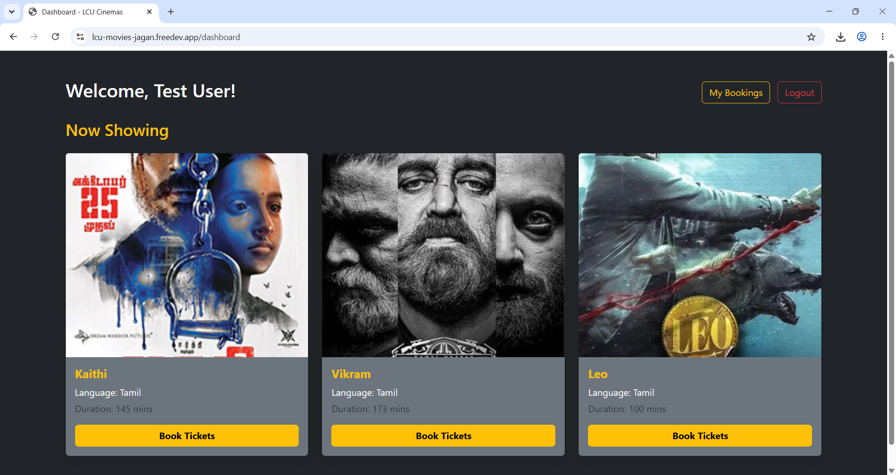
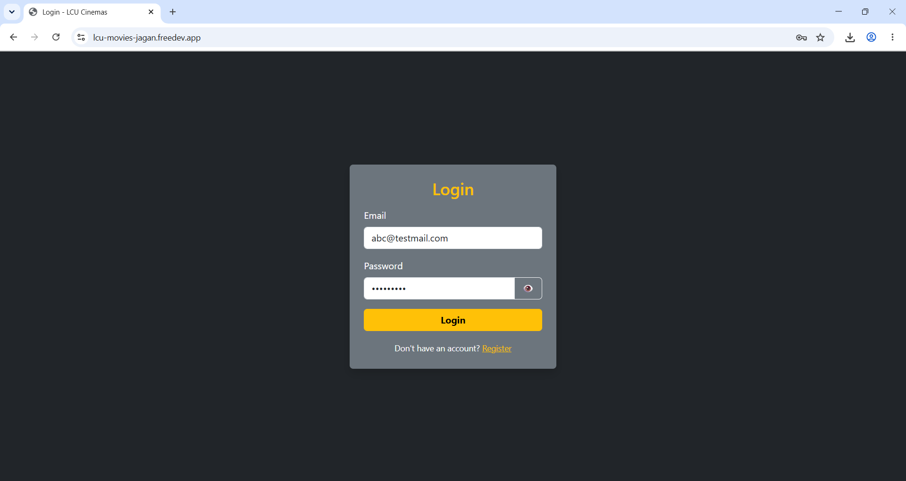
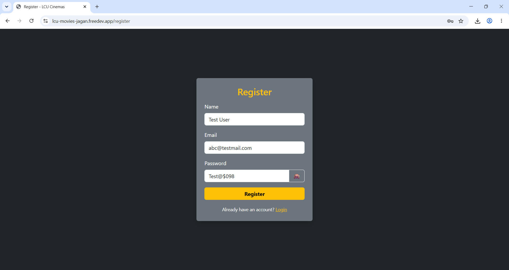
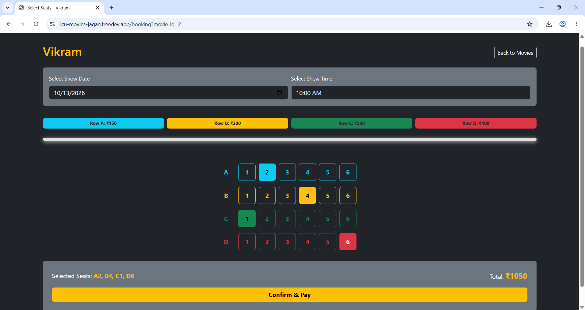
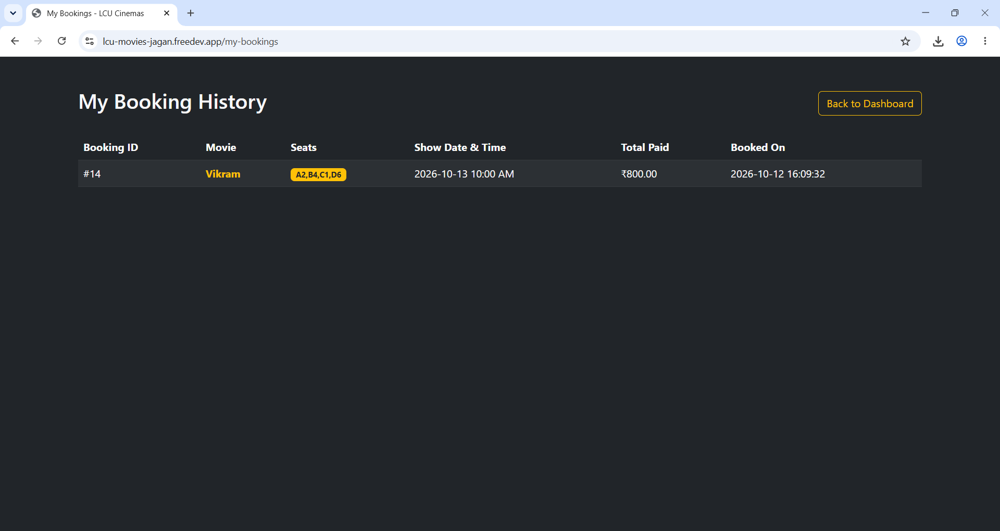
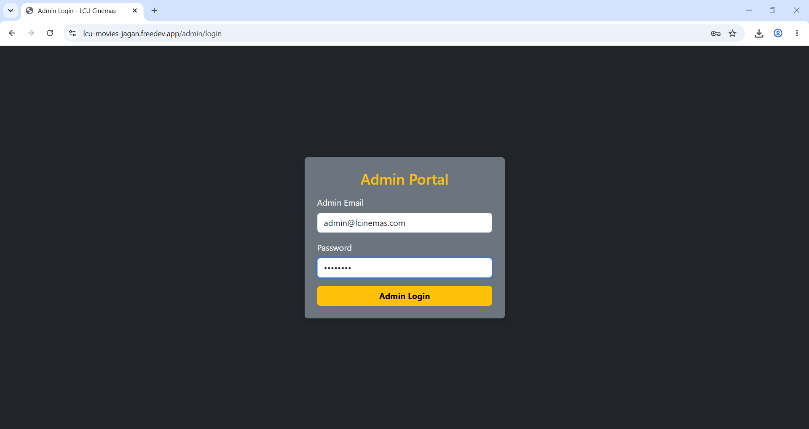
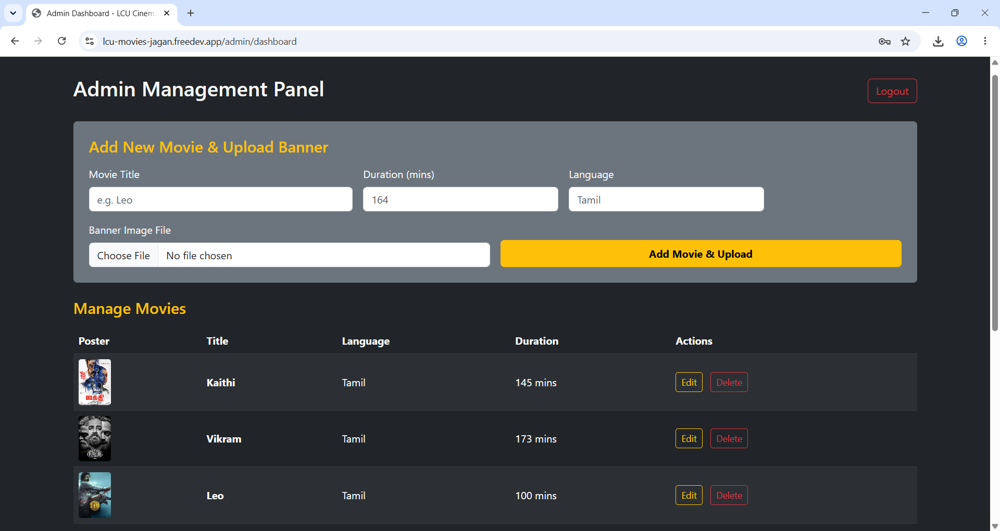
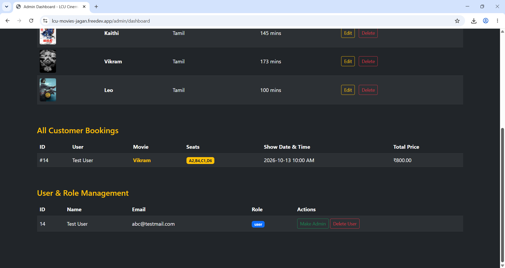

# 🎬 LCU Cinemas - Movie Theatre Management System

**A PHP and MySQL-based Movie Theatre Management System built using the MVC architecture and hosted on InfinityFree.**

LCU Cinemas is a web-based application that allows users to browse movies, select seats, choose show dates and times, and manage their bookings. It also provides an administrative panel for managing movies, uploading banners, viewing customer bookings, and managing user roles.

<p align="center">
  
</p>

<p align="center">
  <b>Live Demo:</b>
  <a href="https://lcu-movies-jagan.freedev.app/">Visit LCU Cinemas</a>
</p>

---

## 📌 Table of Contents

- [About the Project](#-about-the-project)
- [Features](#-features)
- [Screenshots](#-screenshots)
  - [User Authentication](#1-user-authentication)
  - [Movie Dashboard](#2-movie-dashboard)
  - [Movie Booking and Seat Selection](#3-movie-booking-and-seat-selection)
  - [Booking History](#4-booking-history)
  - [Admin Authentication](#5-admin-authentication)
  - [Admin Dashboard](#6-admin-dashboard)
- [Technologies Used](#-technologies-used)
- [MVC Architecture](#%EF%B8%8F-mvc-architecture)
- [Project Structure](#-project-structure)
- [Database Setup](#-database-setup)
- [Installation and Setup](#-installation-and-setup)
- [Deployment on InfinityFree](#-deployment-on-infinityfree)
- [Security Considerations](#-security-considerations)
- [Future Enhancements](#-future-enhancements)
- [Author](#-author)

---

## 📖 About the Project

LCU Cinemas is a movie theatre management and ticket booking application developed as a web development project using PHP and MySQL.

The application follows the **Model–View–Controller (MVC)** design pattern to separate database operations, application logic, and the user interface.

Users can register, log in, browse currently available movies, select seats according to their preferred seating category, choose a show date and time, confirm their booking, and view their booking history.

Administrators can access a dedicated management panel to add movies, upload movie banners, edit or delete movie entries, view customer bookings, and manage user roles.

The project demonstrates practical implementation of server-side programming, database connectivity, authentication, session management, file uploads, responsive UI design, and CRUD operations.

## ✨ Features

### 👤 User Features

- **User Registration:** Create a new account using a name, email address, and password.
- **User Login:** Authenticate registered users.
- **Movie Dashboard:** Browse movies currently available for booking.
- **Movie Details:** View movie posters, titles, languages, and durations.
- **Interactive Seat Selection:** Select seats from a visual theatre layout.
- **Seat Categories:** Choose seats from Rows A, B, C, and D, with different prices.
- **Show Scheduling:** Select a preferred show date and showtime.
- **Automatic Price Calculation:** Calculate the total ticket price according to the selected seats.
- **Booking Confirmation:** Confirm a movie booking through the booking interface.
- **Booking History:** View previously booked movies, selected seats, show dates, and total amounts paid.
- **Session Management:** Maintain user sessions and log out securely.

### 🛠️ Admin Features

- **Admin Authentication:** Access the administrative dashboard through a dedicated login page.
- **Movie Management:** Add, edit, and delete movie records.
- **Movie Banner Upload:** Upload poster or banner images for movies.
- **Booking Overview:** View customer bookings, including booking IDs, users, movies, seats, show dates, and prices.
- **User Management:** View registered users and their account details.
- **Role Management:** Manage user and administrator roles.
- **Admin Logout:** End the administrative session.

## 📸 Screenshots

The following screenshots are stored in the repository's `Screenshots/` directory. GitHub renders them directly from these relative paths.

### 1. User Authentication

#### Login Page

Registered users can enter their email address and password to access the application.

<p align="center">
  
</p>

#### Registration Page

New users can create an account by entering their name, email address, and password.

<p align="center">
  
</p>

### 2. Movie Dashboard

The user dashboard displays available movies with their posters, titles, languages, durations, and booking buttons.

Users can navigate to their booking history or log out of their account.

<p align="center">
  
</p>

### 3. Movie Booking and Seat Selection

The booking interface allows users to choose a show date, select a showtime, and select seats from the theatre seating layout.

Different rows have different ticket prices, and the total amount is calculated based on the selected seats.

<p align="center">
  
</p>

### 4. Booking History

Users can view their booking history, including booking ID, movie title, selected seats, show date and time, total paid, and booking date.

<p align="center">
  
</p>

### 5. Admin Authentication

The admin login page provides a dedicated entry point for authorized administrators.

<p align="center">
  
</p>

### 6. Admin Dashboard

The administration panel provides tools for managing movies, customer bookings, and user accounts.

#### Add Movies and Manage Movie Records

Administrators can add movies by entering their title, duration, language, and banner image. Existing movie records can be edited or deleted.

<p align="center">
  
</p>

#### Customer Booking and User Role Management

The lower section of the administration panel displays customer booking details and provides user and role management actions.

<p align="center">
  
</p>

---

## 🧰 Technologies Used

| Technology | Purpose |
|---|---|
| PHP | Backend application logic and request handling |
| MySQL | Relational database management |
| HTML5 | Web page structure |
| CSS3 | Styling and layout |
| JavaScript | Interactive seat selection and client-side calculations |
| Bootstrap 5 | Responsive UI components and layout |
| Apache | Web server |
| Git | Version control |
| GitHub | Source code repository |
| InfinityFree | Web hosting |

## 🏗️ MVC Architecture

The application follows the Model–View–Controller design pattern.

- **Model:** Handles database connectivity and data-related operations.
- **View:** Contains the user interface, HTML templates, styling, and presentation logic.
- **Controller:** Processes requests, coordinates application logic, and connects the models with the views.

This separation improves code organization, maintainability, and the ability to extend the application.

## 📂 Project Structure

The main application files are organized into the following directories:

```text
movie-theatre-mvc/
│
├── Controller/
│   ├── admin_auth.php
│   ├── auth.php
│   ├── booking.php
│   └── logout.php
│
├── Model/
│   ├── db.php
│   └── schema.sql
│
├── View/
│   ├── css/
│   │   └── style.css
│   │
│   ├── html/
│   │   ├── admin/
│   │   │   ├── dashboard.php
│   │   │   └── login.php
│   │   │
│   │   ├── booking.php
│   │   ├── dashboard.php
│   │   ├── login.php
│   │   ├── my_bookings.php
│   │   ├── register.php
│   │   └── ticket.php
│   │
│   └── uploads/
│       └── Movie banner images
│
├── Screenshots/
│   ├── admin_dashboard1.png
│   ├── admin_dashboard2.png
│   ├── admin_login.png
│   ├── booking.png
│   ├── login.png
│   ├── my_bookings.png
│   ├── register.png
│   └── user_dashboard.png
│
└── README.md
```

*Note: This tree highlights the main application files. Additional files present in the repository should be retained.*

## 🗄️ Database Setup

The application uses MySQL to store and retrieve application data.

The database must support the following entities:

| Table / Entity | Purpose |
|---|---|
| `users` | Stores user account information and roles |
| `movies` | Stores movie titles, languages, durations, and banner references |
| `bookings` | Stores booking details, selected seats, show schedules, and prices |

The exact columns and relationships should match the SQL schema and queries used by the application.

### Database Configuration

Update the database connection settings in `Model/db.php` according to your environment.

For local development, use the credentials configured in your local MySQL installation. For InfinityFree, use the database hostname, database name, username, and password provided in your hosting control panel.

**Important:** Before deployment, verify that `Model/schema.sql` defines all required tables and columns referenced throughout the PHP application. The database schema must be complete and consistent with the application code.

## 💻 Installation and Setup

### Prerequisites

Install or arrange the following:

- PHP with the required MySQL extension
- MySQL or MariaDB
- Apache or another compatible PHP web server
- Git, or a downloaded copy of the repository
- A browser such as Chrome, Firefox, or Edge

### Step 1: Clone the Repository

Replace the placeholders with your actual GitHub username and repository name.

```bash
git clone https://github.com/tech-man2007/movie-theatre-mvc.git
```

Navigate to the project directory:

```bash
cd movie-theatre-mvc
```

### Step 2: Configure the Web Server

For a typical XAMPP installation, place the project inside the `htdocs` directory.

Start Apache and MySQL using the XAMPP Control Panel.

### Step 3: Create the Database

1. Open phpMyAdmin.
2. Create a new database.
3. Import the SQL file from `Model/schema.sql`.
4. Confirm that all tables and required columns exist.
5. Add initial movie records if the application does not already provide them.

### Step 4: Configure Database Credentials

Open `Model/db.php` and enter the credentials for your local database.

Ensure that the connection settings match the database created in the previous step.

### Step 5: Launch the Application

Open the local application URL in your browser, using the entry point supported by the repository's routing configuration.

For a standard XAMPP setup, a direct PHP entry point may resemble:

```text
http://localhost/movie-theatre-mvc-main/View/html/login.php
```

If the project uses a custom router or rewrite rules, use the configured application entry point instead.

### Step 6: Test the Application

- Register a new user.
- Log in to the application.
- Browse the available movies.
- Select a movie and choose seats.
- Select a show date and time.
- Complete the booking flow.
- View the booking history.
- Test administrative movie and user management with an authorized administrator account.

## 🌐 Deployment on InfinityFree

The application is deployed on InfinityFree and can be accessed through the live demo link above.

To deploy a copy of the project:

1. Create an InfinityFree hosting account and configure your domain or subdomain.
2. Create a MySQL database through the hosting control panel.
3. Import the complete application database schema using phpMyAdmin.
4. Upload the application files into the website's correct document root, normally `htdocs`.
5. Update `Model/db.php` with the hosting database credentials.
6. Verify the required PHP version and MySQL extension support.
7. Ensure the movie upload directory has appropriate permissions.
8. Visit the deployed website and test the user and admin workflows.
9. Check the server logs and application behavior if any page fails to load.

**Deployment note:** Local database settings cannot automatically be reused on InfinityFree. Always use the connection details supplied by the hosting provider.

## 🔐 Security Considerations

Security is important for an application that handles user accounts, bookings, and administrative functions.

Recommended practices include:

- Store passwords using PHP's `password_hash()` and verify them with `password_verify()`.
- Use prepared statements for database queries that contain user-supplied values.
- Validate and sanitize input on the server side.
- Escape output when rendering user-controlled content.
- Restrict administrative pages and actions to authorized administrators.
- Validate uploaded files by type, size, and content.
- Store sensitive credentials outside the public repository.
- Use HTTPS in production.
- Regenerate session IDs after authentication and configure secure session handling.
- Add CSRF protection to sensitive state-changing actions.
- Validate seat availability on the server before confirming bookings.
- Use database transactions where needed to keep booking records consistent.

Before making the repository public, remove hardcoded administrator credentials and ensure that screenshots and sample data do not expose real passwords or other sensitive information.

## 🚀 Future Enhancements

Possible improvements include:

- Online payment gateway integration.
- Email confirmations and booking notifications.
- QR-code-based ticket verification.
- Movie search and filtering.
- Show management and configurable show schedules.
- Better handling of concurrent seat bookings.
- Password reset and email verification.
- Booking cancellation and refund workflows.
- Enhanced admin audit logs.
- Automated database backups.
- Improved automated testing and deployment.

## 🎯 Project Objective

The primary objective of LCU Cinemas is to develop a functional, database-driven movie theatre management platform that demonstrates PHP web development, MVC architecture, database integration, authentication, CRUD operations, interactive seat selection, and role-based administration.

The project also provides practical experience in deploying a PHP and MySQL application to a shared hosting environment.

## 👨‍💻 Author

**Your Name**

- GitHub: [tech-man2007](https://github.com/tech-man2007)
- Repository: [Movie Theatre - MVC](https://github.com/tech-man2007/movie-theatre-mvc)
- Live Demo: [LCU Cinemas](https://lcu-movies-jagan.freedev.app/)

---

<p align="center">
  <b>🎬 LCU Cinemas</b><br>
  Movie Theatre Management System built with PHP, MySQL, and MVC.
</p>
